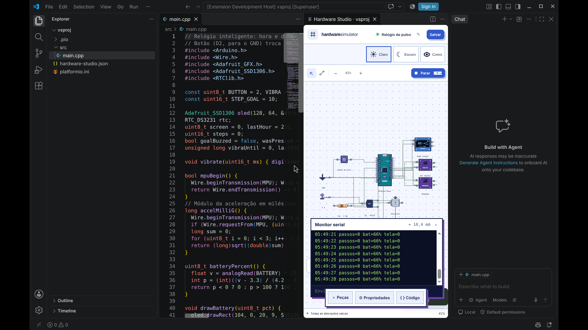

# Hardware Studio

Uma oficina aberta para experimentar hardware no navegador. A entrada em **pixel art animada** já contém um circuito RC interativo: fonte, resistor e capacitor compartilham o mesmo modelo elétrico da bancada.

## Executar

Não há etapa de build nem dependências de runtime. Sirva a pasta por HTTP (módulos ES não devem ser abertos por `file://`):

```sh
python3 -m http.server 8080
```

Abra `http://localhost:8080`. O aplicativo não exige conta, não envia projetos a um backend e não carrega fontes de terceiros. A hospedagem de uma prévia pode exigir autenticação do provedor.

- `index.html`: oficina animada; 12 V, 32 V e 100× com desfecho calculado e relógio real.
- `studio.html`: bancada de medição, cenários editáveis, biblioteca e validação.
- `editor.html`: editor livre com peças em pixel art, fios, sketch Arduino simplificado e projetos JSON.
- `lab/sn74hc595.html`: registrador digital interativo.
- `boot.html`: dá boot no `firmware.hex` do PlatformIO num Arduino Uno, Nano ou Mega 2560 emulado (o chip é detectado pelo arquivo).
- `avc.html`: HS-Pulse, pulseira de triagem de FA emulada + edge com CHA₂DS₂-VASc e pré-laudo (RAG/LLM local opcional).
- `watch.html`: vitrine do relógio inteligente rodando firmware real, em 3D, com a PCB redonda por dentro.
- `pcb.html`: placa de circuito impresso do circuito (redonda de relógio ou retangular), roteamento, DRC e Gerbers.
- `node tools/studio-server.mjs`: o mesmo Studio, compilando projetos PlatformIO inteiros (ver abaixo).

## Arquitetura

Peças, projetos e chips são unidades declarativas: uma peça nova é uma entrada em `src/parts/catalog.js` (pinos, como o firmware a enxerga, footprint, ajustes); um projeto novo é uma pasta listada em `examples/index.json`; o circuito vira dispositivos emulados por um único caminho (`src/core/bind.mjs`), usado pelo editor, pelas vitrines (`src/core/rig.mjs`), pela linha de comando e pelos testes. Detalhes, contratos e receitas em [docs/ARCHITECTURE.md](docs/ARCHITECTURE.md).

## Tour em vídeo

[docs/media/hardware-studio-tour.mp4](docs/media/hardware-studio-tour.mp4) (1min48, 1080p, com trilha chiptune original) mostra as animações da oficina, a bancada, o editor com três projetos que combinam placas, o registrador e os testes. O roteiro em [tools/demo-video](tools/demo-video/README.md) regrava o vídeo.

## Boot de firmware (Arduino Uno e Mega 2560)

Igual ao fluxo que você já usa com PlatformIO: **o PlatformIO compila, o Hardware Studio dá boot**. O emulador AVR (`src/emulator/avr.mjs`) foi escrito para este projeto e executa cada instrução do `firmware.hex` num ATmega328P (`board = uno`) ou ATmega2560 (`board = megaatmega2560`). O chip sai da tabela de vetores do arquivo (26 vetores no Uno, 57 no Mega); `--mcu` força um deles.

| Periférico | Funciona com |
| --- | --- |
| GPIO, pull-up, `digitalRead/Write` | botões, LEDs, qualquer pino D0–D13 e A0–A5 |
| Timer0/1/2, PWM | `millis`, `delay`, `analogWrite`, `Servo`, `tone` |
| USART0 TX/RX | `Serial.print`, `Serial.read` (ritmo real do baud) |
| ADC 10 bits | `analogRead` (potenciômetro) |
| INT0/INT1, PCINT | `attachInterrupt`, ISRs de troca de pino |
| EEPROM 1 KB | `EEPROM.get/put/update` (guardada entre resets e no navegador) |
| Watchdog e sleep | `wdt_enable`, reset por watchdog, `sleep_cpu` (idle e power-down) |
| SPI mestre | `SPI.transfer` com dispositivo plugável |
| I²C (TWI) mestre e escravo | `Wire`, `LiquidCrystal_I2C` (LCD 0x27), `Adafruit_SSD1306` (OLED 0x3C), BME280, MPU6050, DS3231 (RTClib), BH1750; dois Unos com `Wire.onReceive/onRequest` |
| SPI mestre e escravo; USART em SPI (MSPIM) | `SPI.transfer`, dois Unos com SS no D10 |
| Um fio e pulsos | DHT11/DHT22 (Adafruit DHT), NeoPixel WS2812 (Adafruit NeoPixel e FastLED) |
| Bit-banging e laços de ciclos | `SoftwareSerial`, `pulseIn`, `shiftOut/shiftIn`, `tone` com duração, `Stepper`, `TimerOne`, 12 `Servo` ao mesmo tempo |
| HC-SR04 | `pulseIn` e NewPing: eco com o tempo de ida e volta do som (c = 331,3 + 0,606·T), 38 ms fora de 2–400 cm |
| LCD direto nos pinos | `LiquidCrystal` em 4 ou 8 bits (caracteres criados aparecem com os 5×8 pontos; `print` logo após `createChar` vai para a CGRAM, como no HD44780 real) |
| Comparador, captura do Timer1, referências do ADC | `ACSR`/AIN0/AIN1, `ICR1` no D8, `analogReference(INTERNAL)` |
| Consumo | estimativa pelo datasheet: ~10,4 mA ativo, ~2,4 mA idle, µA em power-down (Mega: ~20 mA ativo) |

No **Mega 2560** vale tudo acima e mais: 256 KB de flash (PC de 17 bits, `ELPM`/`pgm_read_byte_far`, `EICALL`), 8 KB de RAM, 4 KB de EEPROM, portas A–L (D0–D53, A0–A15), Timers 3/4/5 com canal C (15 pinos PWM), `Serial1`–`Serial3`, INT0–INT7, PCINT nas portas B/E/J/K, ADC8–ADC15 e a referência de 2,56 V. I²C fica no D20/D21 e SPI no D50–D53, como na placa. Firmware de um chip carregado no outro é recusado com o motivo, como faz o `avrdude`.

```sh
# no platformio.ini do seu projeto
extra_scripts = post:/caminho/para/hardware-simulator/tools/platformio/simulate.py

pio run -t simulate                                       # compila e roda em tempo real
SIM_ARGS="--seconds 5 --pins --lcd --oled" pio run -t simulate
node tools/avr-run.mjs .pio/build/uno/firmware.hex --lcd --eeprom eeprom.bin
node tools/avr-run.mjs .pio/build/megaatmega2560/firmware.hex   # Serial1–3 aparecem como [Serial1] …
node tools/avr-run.mjs firmware.hex --circuit hardware-studio.json --seconds 3   # com as peças do circuito do projeto
```

O `simulate.py` passa o `build.mcu` da placa do `platformio.ini` para o emulador.

- **Navegador (`boot.html`):** solte o `firmware.hex`, use **Vigiar arquivo** (Chrome/Edge) e cada `pio run` reinicia o chip. Monitor serial, botões nos pinos, potenciômetro em qualquer entrada analógica, envio para Serial…Serial3 no Mega, LCD, OLED, pulsos medidos (servo em graus, frequência do `tone`) e som do `tone()`.
- **Editor (`editor.html`):** selecione o Uno ou o Mega 2560 → **Carregar .hex** (ou **Vigiar**). O circuito é resolvido em corrente contínua (`src/editor/circuit.js`): resistores com o valor escrito, pinos com 25 Ω de saída, pull-up interno de 35 kΩ, LEDs e diodos com Vf, NPN com corte/saturação/região ativa (Ic = hFE·Ib, hFE 100), capacitores que carregam no tempo da simulação (Euler implícito), relé e porta AND. Assim o firmware lê o que o circuito real daria (botão com pull-down, divisor com LDR no `analogRead`) e o editor avisa quando um LED passa de 30 mA ou um pino passa de 40 mA. Com a simulação rodando, o botão é momentâneo (conduz enquanto você segura) e trepida como uma chave real (2–5 trocas em ~2 ms; dá para desligar por peça), o servo anda a 600°/s como um SG90 e o motor tem inércia. O firmware real move o circuito: LEDs (com brilho de PWM), buzzer com som, botões e chaves viram entradas, potenciômetro vira tensão no pino analógico, servo gira, LCD e OLED ligados no I²C da placa (A4/A5 no Uno, D20/D21 no Mega) mostram a tela. Exemplo pronto: importe `examples/firmware/painel-projeto.json` (fonte em `examples/firmware/painel`).

No editor, placas se falam por serial (TX→RX; no Mega também TX1/RX1 D18/D19, TX2/RX2 D16/D17, TX3/RX3 D14/D15), I²C (SDA/SCL em comum) ou SPI (SCK/MOSI e SS); os chips ligados rodam em passo de 10 µs. Fica de fora outra arquitetura de CPU (ESP32/ESP-IDF, Xtensa/RISC-V): é outro emulador inteiro. `node tests/avr.mjs` roda os testes com firmwares reais compilados pelo PlatformIO (`tests/fixtures/avr`) e repete a suíte do Uno com os mesmos firmwares compilados para o Mega (`tests/fixtures/avr/mega`). Onde o chip real erra, o emulador erra igual: `pulseIn` lê alguns µs a menos porque o ISR do `millis` pausa o laço de contagem.

## Projeto inteiro: pasta → compila → roda (VS Code ou navegador)

Um projeto PlatformIO é um conjunto de arquivos: `platformio.ini`, `src/`, `include/`, `lib/` e, aqui, um `hardware-studio.json` com o circuito (peças, fios e ajustes). O Hardware Studio compila esse conjunto com o **seu** PlatformIO e roda o firmware no circuito, sem copiar `.hex` à mão.

```sh
node tools/studio-server.mjs --project caminho/do/projeto   # vigia a pasta: cada salvar recompila e reinicia a simulação
node tools/studio-server.mjs                               # sem pasta: no editor, placa → "Compilar pasta…"
```



- **Extensão do VS Code** (`vscode/`, 187 KB): `cd vscode && npm run package` gera o `.vsix`; instale com *Extensions → Install from VSIX*. O comando **Hardware Studio: Simular projeto PlatformIO** abre o Studio ao lado do código, compila ao abrir e a cada salvar, e carrega o circuito do `hardware-studio.json`. Mudanças no circuito feitas no Studio voltam para esse arquivo; editar o arquivo no VS Code atualiza o Studio.
- **Navegador:** com o servidor rodando, selecione a placa e use **Compilar pasta…** (no Chrome/Edge aparece também **Recompilar**). Se a pasta tiver `hardware-studio.json`, o circuito vem junto.
- O `[env]` usado é o do `default_envs`, a menos que outro `[env]` seja para o chip da placa selecionada (ex.: o mesmo projeto com `nano` e `mega`). Alvos que o emulador não executa (8 MHz, ESP32) compilam e dizem o motivo.
- O servidor só escuta em 127.0.0.1 e recusa pedidos de páginas de outra origem.

Exemplo: [`examples/firmware/relogio`](examples/firmware/relogio) é um relógio de pulso (Arduino Nano, OLED SSD1306, RTC DS3231, passos pelo MPU6050 em 0x69, botão de tela, vibracall com transistor e bateria Li-ion num divisor). No editor, **Exemplos → Relógio de pulso**; no controle **Caminhada** do MPU6050 o relógio conta passos e vibra na meta.

## HS-Pulse: triagem de fibrilação atrial e risco de AVC (`avc.html`)

Inspirado no *Wearable Stroke Alert System* (Health of Things + edge + IA generativa, SBESC 2024) e no Pulse-PPG (Saha et al., IMWUT 2025), que aprende com o ruído de PPG de campo. O hardware mede o que um pulso consegue medir de verdade: o ritmo. A fibrilação atrial multiplica o risco de AVC e muitas vezes não dá sintoma.

- **Pulseira** (`examples/firmware/pulseira-avc`, ATmega328P, 21 KB): MAX30102 no pulso, MPU6050 para qualidade do sinal, tela GC9A01, vibracall e SOS. Cada batimento vira um intervalo RR contado em amostras do sensor; batimentos com o braço em movimento são descartados; a irregularidade é a mediana das diferenças sucessivas dividida pela mediana dos RR (a ideia do nRMSSD com medianas: com RMSSD, um único batimento detectado errado gerava falso alerta, achado no simulador); 3 janelas acima de 0,08 = suspeita de FA. A telemetria sai em JSON pela serial, onde ficaria o BLE.
- **Emulador:** o MAX30102 gera ritmo sinusal com variabilidade de ~3 %, FA com intervalos irregularmente irregulares (±35 %) e artefato de movimento.
- **Edge (`avc.html`):** recebe a telemetria, desenha Poincaré e tacograma, calcula CHA₂DS₂-VASc/CHA₂DS₂-VA com o risco anual aproximado (Friberg 2012) e escreve um pré-laudo: modelo determinístico ou Llama 3 local via Ollama (`ollama run llama3`) com trechos de diretrizes recuperados por palavra-chave (RAG).
- **Avaliação:** `node tools/eval-af.mjs` roda o firmware emulado em janelas de 40 s (sinusal 50–110 bpm, FA 70–140 bpm). Resultado atual em 24 janelas: sensibilidade 12/12, especificidade 12/12. Isso vale para sinais sintéticos e mostra que o firmware faz o que foi desenhado para fazer; não é evidência clínica. Para isso: dados reais rotulados (ex.: bases públicas de PPG com FA), divisão por paciente e balanceamento só no treino.
- **PCB:** `pcb.html?example=pulseira-avc-placa` (Ø40 mm, ATmega328P em TQFP, DRC limpo).

## Projetos prontos (pasta PlatformIO + circuito + firmware + PCB)

| Projeto | O que faz | Peças |
| --- | --- | --- |
| `examples/firmware/queda` | Pulseira detectora de queda: queda livre → impacto → imobilidade deitada; 10 s para cancelar no botão, depois sirene e alerta | Nano, MPU6050 (±8 g), OLED, botão, buzzer, vibracall |
| `examples/firmware/bengala` | Bengala inteligente: vibração e bipes proporcionais à distância do obstáculo (até 2 m), modo silencioso | Nano, HC-SR04, vibracall PWM, buzzer, OLED, botão |
| `examples/firmware/estacao` | Estação de conforto: índice de calor (Rothfusz/NWS) e iluminação (500 lx) numa barra de NeoPixels, aviso de calor perigoso | Nano, BME280, BH1750, NeoPixel ×8, OLED, buzzer |
| `examples/firmware/relogio-cor` | Relógio redondo colorido com batimento, SpO2 e passos | Nano/ATmega328P, GC9A01, MAX30102, DS3231, MPU6050 |

Cada pasta abre direto no editor (**Exemplos**), no VS Code ou com `node tools/studio-server.mjs --project examples/firmware/<nome>`, e vira PCB em `pcb.html`. Os testes rodam o firmware compilado de cada um e o roteamento da placa. Escrever os testes achou dois bugs reais no firmware da pulseira (`ms - since` negativo em `unsigned long` pulava estados), corrigidos no código.

## Vitrine: relógio aberto (`watch.html`)

Um relógio inteligente que ainda não existe, rodando: o firmware `examples/firmware/relogio-cor` (tela redonda GC9A01, batimento e SpO2 no MAX30102, passos, hora, vibracall) roda no ATmega328P emulado direto no navegador, dentro de um relógio em 3D feito só de CSS. **Abrir em camadas** separa vidro, tela, caixa, a PCB redonda gerada e verificada na hora, bateria e tampa; arraste para girar. Os controles mudam o batimento, a caminhada e a tensão da bateria; o botão lateral é o D2 do firmware e o relógio treme quando o vibracall liga. **Baixar Gerbers** entrega a placa para fabricar. Vídeo: [docs/media/relogio-hs1.mp4](docs/media/relogio-hs1.mp4).

## PCB: do circuito à placa para fabricar

`pcb.html` (botão **PCB** no editor) transforma o circuito numa placa de 2 camadas: cada peça ganha um footprint real (ATmega328P em TQFP-32, resistores e capacitores 0805, MMBT3904 em SOT-23, 1N4148W em SOD-123, cristal 3225, botão 6 × 6, JST-PH para a bateria; módulos como OLED, RTC e IMU entram como conectores 1×4), o posicionamento automático cabe tudo numa placa **redonda de relógio** (ou retangular) e cresce o diâmetro se precisar, e o autorroteador (A* em grade de 0,2 mm, 45°, vias) liga todas as redes num Web Worker. Arraste peças com mouse ou toque, ou selecione com Tab e use as setas (Shift = 1 mm, R gira): a placa é roteada de novo a cada movimento. Vistas 2D, 3D (arraste para girar) e por baixo; máscara verde, preta, roxa, azul ou branca.

O **DRC** é independente do roteador: mede a geometria exata (trilha × trilha, trilha × pad, pad × pad, vias) contra a isolação de 0,2 mm, a distância da borda, sobreposição de componentes e redes abertas. **Baixar fabricação** gera um .zip com Gerber RS-274X X2 (GTL, GBL, GTS, GBS, GTO, GTP, GKO), furação Excellon, BOM e posição para montagem (CSV) com sugestões de peças LCSC. Os arquivos do exemplo foram abertos por um leitor independente (gerbonara), que reconheceu todas as camadas, os 24 furos e o contorno de 40 mm.

Exemplo: **Exemplos → Relógio em placa própria** no editor (ATmega328P, cristal de 16 MHz com 22 pF, 100 nF de desacoplamento, sensores, vibracall e leitura da bateria) e depois **PCB**, ou `pcb.html?example=relogio-placa`. O chip só dá boot no editor com alimentação, AVCC ligado e cristal, como na placa real.

O que o software não garante: um DRC limpo diz que a placa respeita as regras de fabricação e que cada rede está ligada; não substitui conferir o esquema, a pinagem dos módulos que você vai comprar, a corrente que a bateria aguenta e o primeiro protótipo em bancada.

## Aparência

Use **Claro** ou **Escuro** para mudar a oficina e as telas de simulação. A escolha inicial acompanha o sistema. O ajuste **Cores** é independente do tema:

1. Desativado: clique duas vezes em **Cores**, sem precisar de um duplo clique rápido. O segundo clique abre o popup.
2. Confirme **Usar cores acessíveis** para aplicar azul/dourado, contraste e pistas por símbolos/padrões nos dois temas.
3. Ativado: um clique abre o popup. Desmarque a opção e confirme para desligar. Cancelar ou Escape mantém a preferência anterior.

A oficina também tem uma pista óptica clicável experimental. Ela não é uma placa de Ishihara calibrada, não identifica daltonismo e não garante que apenas pessoas daltônicas a enxerguem. O acesso equivalente por botão e teclado permanece disponível. Não é necessário declarar nenhuma condição. Só a preferência de aparência é salva localmente.

O tema escuro traz lua, estrelas e iluminação noturna; o claro traz sol e uma paleta azul/lilás. Clique no robô para ele acenar.

A entrada é animada: o título sobe palavra por palavra, a bancada liga como um monitor CRT e cada clique solta pixels. A barra **Descobertas** marca cinco achados (carga, sobretensão, ruptura, troca de peça e o robô) e celebra quando completa. Os cartuchos inclinam com o mouse e “encaixam” ao abrir. Nada disso é salvo, e tudo desliga com **Pausar movimento** ou com movimento reduzido do sistema.

Textos complementares ficam em abinhas (ⓘ) que abrem e recolhem; os limites dos modelos continuam lá dentro.

## O que funciona

| Recurso | Escopo atual |
| --- | --- |
| Capacitor | Carga com fonte CV/CC, fuga real acima da nominal, aquecimento, H₂, pressão e válvula; falha manual opcional |
| Resistor | SFR25 com aquecimento (200 K/W), escurecimento, fumaça e abertura |
| LED | Diodo de Shockley ajustado ao datasheet, junção aquecendo, perda de brilho, avalanche reversa e queima |
| SN74HC595 | Modelo lógico, estados X/Z, clocks, latch, clear e OE; todos os 256 bytes testados |
| Biblioteca | 114 referências oficiais de placas, SoCs, MCUs e periféricos; cada item mostra o estado do modelo |
| Editor livre | Montagem, fios, peças personalizadas, projetos JSON, gavetas no celular; cada peça diz se é simulada ou só visual |
| Sketch no editor | `setup()` uma vez e `loop()` repetido, constantes, `#define`, `LED_BUILTIN`, `for`, `if`, `digitalWrite`, `delay`; o resto vira aviso |
| Arduino / PlatformIO | Exportação de exemplo `.ino` ou projeto ZIP; sem compilação, upload ou plugin de IDE ainda |

**114 referências não são 114 dispositivos emulados.** O catálogo amplia a pesquisa, enquanto os modelos funcionais são os explicitados acima. No editor, LEDs, buzzer, chaves, resistores, fontes e o Uno participam da simulação lógica de continuidade; sensores, motores, displays e demais peças são só visuais e o inspetor avisa. O editor não compila C++ e não usa o motor analógico da bancada.

## O que acontece de verdade

A bancada e a oficina usam o mesmo motor eletrotérmico (`src/engine/physics.mjs`). O desfecho sai da física, não de um gatilho:

| Cenário | Desfecho calculado | Base |
| --- | --- | --- |
| 12 V em C1 de 16 V | Carrega; nada esquenta | Fuga 0,01·C·V (16 µA) |
| 32 V (2×) via 1 kΩ | C1 trava em ~21,6 V como um zener, esquenta, gera H₂ e abre a válvula em **minutos** | CDE: "modo tensão constante… o hidrogênio gera pressão e falha" |
| 1.600 V (100×) via 1 kΩ, fonte de 200 mA | **R1 queima primeiro** (40 W num resistor de 0,4 W): escurece em ~1 s, fumaça em ~1,5 s, abre em ~3 s. C1 só esquenta | Vishay SFR25: 0,4 W, 200 K/W, 155 °C |
| 30 V / 3 A direto | Válvula abre em ~1 s, sem estilhaços | Nichicon: válvula ensaiada sem chamas nem fragmentos |
| Válvula obstruída | Só aqui a lata estoura | Nichicon: função da válvula |
| Capacitor invertido a 1 A | Conduz e ventila em segundos | Nichicon: ensaio reverso de 1 A |
| LED sem resistor (5 V) | ~280 mA, junção passa de 125 °C e o chip abre em ~2 s | Kingbright: IF 30 mA, RthJA 560 °C/W |

Números que nenhum datasheet traz (capacidade térmica, volume livre da lata, pressão de abertura da válvula, temperaturas em que a laca fuma) são **premissas declaradas** e aparecem em **Ver fontes**. Os tempos são estimativas da ordem de grandeza, não certificação. A falha manual (aberto/curto) continua disponível para estudo.

Veja [modelos elétricos e evidências](docs/ELECTRICAL_MODELS.md) e [primeira validação digital](docs/FIRST_VALIDATION.md).

## Testar

```sh
node tests/all.mjs
node tests/avr.mjs
node tests/editor.mjs
node tests/parts.mjs        # contrato de cada peça do catálogo (+ prova de extensão com o TMP117)
node tests/projects.mjs     # cada projeto do manifesto: boot pelo rig e placa sem violações
node tests/browser.mjs      # modelos elétricos e inspector no editor real (Playwright)
node tests/pcb.mjs          # netlist, roteamento, DRC e arquivos de fabricação
node tests/build.mjs        # compila o relógio de exemplo com o PlatformIO (pulado sem pio)
node tests/display-contrast.mjs
cd vscode && npm test       # extensão com um VS Code simulado
```

24 grupos: 8 digitais + 16 elétricos. Incluem os 256 valores do registrador, solução RC fechada, partição de passos, balanço de potência em 500 configurações e consequências das falhas. `tests/editor.mjs` cobre o interpretador de sketch do editor (13 casos, incluindo que expressões não executam código arbitrário). Os 24 grupos também podem ser executados em **Bancada → Validação** e exportados como JSON. Não são ensaios destrutivos de hardware físico.

`tools/a11y-audit.cjs` roda o axe-core em todas as páginas (desktop e celular) e falha com qualquer violação ou rolagem horizontal; hoje: zero violações. As placas do PCB e as peças da bancada são operáveis por teclado (Tab, setas, Enter) e têm nome acessível.

A verificação de aparência testa 80 pares de tokens reais de texto/fundo nas quatro paletas contra 4,5:1. Ela não equivale a uma auditoria completa de acessibilidade nem a validação clínica da pista óptica.

## Desempenho e acessibilidade

- Canvas original de 560 × 365, sem motor 3D, vídeo ou framework.
- Oficina limitada a 24 desenhos/s e leituras a aproximadamente 6 Hz; pausa fora da área visível e ao ocultar a página.
- Bancada: passo simulado de 5 ms, pintura até 30 Hz e histórico limitado a 360 pontos.
- Movimento reduzido respeitado; botão para pausar todas as animações da entrada.
- Controles nativos, foco visível, informações de tensão/corrente fora do canvas.
- Fontes servidas localmente. Pixelify Sans está sob SIL OFL; código e arte procedural do projeto sob MIT.

## Contribuir e próximos modelos

Veja [CONTRIBUTING.md](CONTRIBUTING.md), [problemas e decisões](docs/RESEARCH_AND_DESIGN.md), [catálogo](docs/HARDWARE_CATALOG.md), [arquitetura](docs/SIMULATOR_ARCHITECTURE.md) e [adaptadores de IDE](docs/TOOLCHAIN_ADAPTERS.md).

PCB, SPICE, emulação completa de MCU/SoC, protocolos e wearable completo permanecem no plano. Os arquivos de arquitetura e adaptadores descrevem direção; não prometem suporte executável hoje.

## Licença

[MIT](LICENSE). Fonte: [Pixelify Sans / SIL OFL](assets/fonts/OFL.txt). Referências de fabricantes mantêm seus direitos; links não representam redistribuição dos datasheets.
